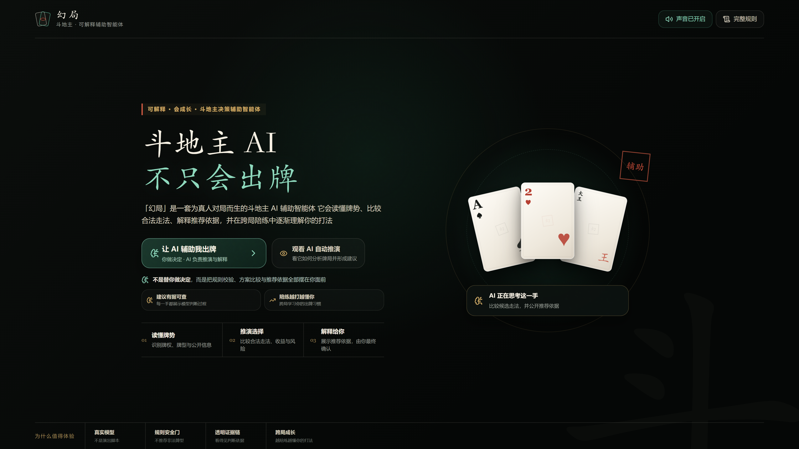
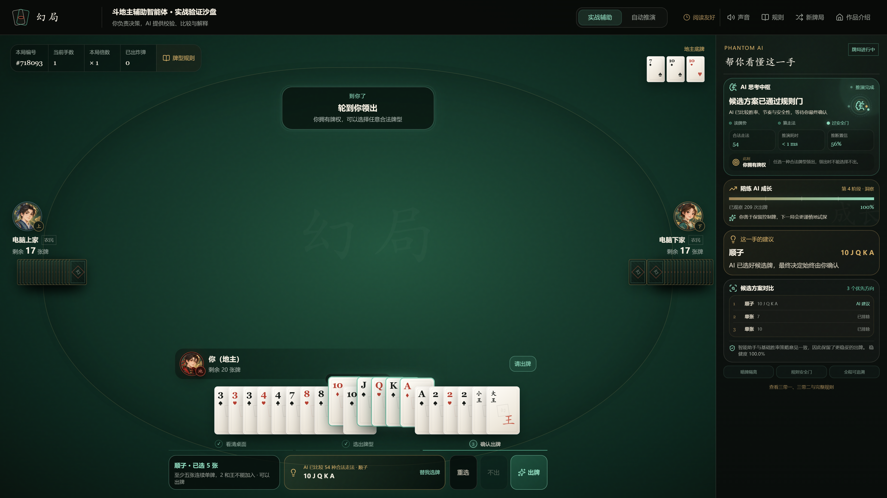
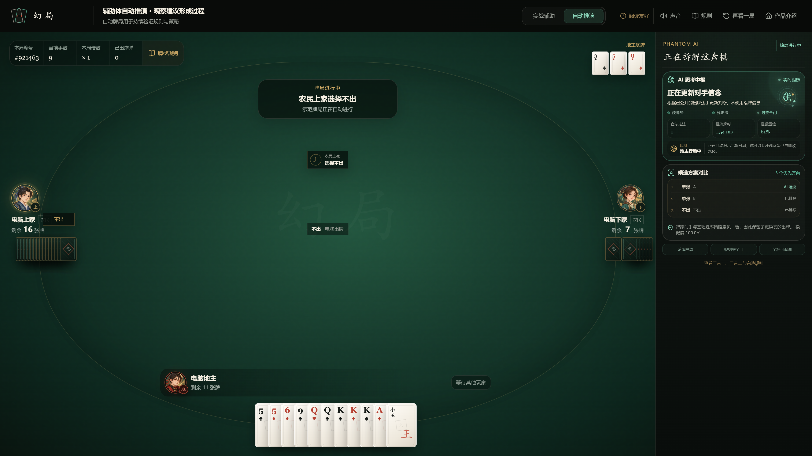
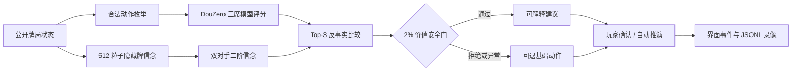

<div align="center">

# 幻局 · PHANTOM

### 可解释、会成长、由真实 DouZero 驱动的斗地主辅助智能体

<p>
  <strong>读懂牌势 · 比较候选 · 解释依据 · 玩家决策</strong>
</p>


</div>

<a href="./docs/screenshots/phantom-home-4k.png">
  
</a>

> **幻局不是替你出牌的黑箱。** 它会读取公开牌势，枚举并校验合法动作，比较候选方案，展示推荐依据与风险边界，最终决定始终交给玩家。

## ✦ 项目亮点

| 能力 | 说明 |
| --- | --- |
| **真实模型推理** | 内置三席 DouZero ADP 权重，对当前全部合法动作进行真实评分，不使用伪造 AI 数据。 |
| **规则安全门** | 所有建议都会经过牌型与压制关系校验；认知候选若损失超过 2% 的基础价值会被硬拒绝。 |
| **可解释候选比较** | 同屏展示 Top-3 走法、基础价值、推荐理由、置信度与数据来源。 |
| **隐藏牌信念** | 基于公开信息维护 512 个合法粒子，不读取对手真实手牌。 |
| **跨局陪练成长** | 观察过牌、抢牌权与大牌使用习惯，在后续牌局的安全近似候选中调整应对。 |
| **完整斗地主规则** | 支持单张、对子、三张、三带一/二、顺子、连对、飞机、四带二、炸弹、王炸、倍率与春天结算。 |
| **沉浸式国风界面** | 真实三席牌桌、发牌与出牌动效、原创角色、分层声场和 627 条离线中文报牌。 |
| **全程可追溯** | 动作、候选、信念、来源和状态机写入 JSONL 录像，可复现与审计。 |

## 📷 4K 实机截图

以下截图均来自本地真实运行环境，原始分辨率为 **3840 × 2160**；点击图片可查看原图。

| 实战辅助：AI 代选后由玩家确认 | 自动推演：观察建议形成过程 |
| --- | --- |
| <a href="./docs/screenshots/phantom-assist-4k.png"></a> | <a href="./docs/screenshots/phantom-autoplay-4k.png"></a> |

## 🚀 快速开始

### 环境要求

- Windows 10 / 11（推荐）
- Python 3.11+
- Node.js 22.13+
- 约 2 GB 可用磁盘空间用于依赖安装

模型权重已随仓库提供，游戏运行过程完全可以离线完成。

### 1. 克隆与安装

```powershell
git clone https://github.com/wolfgang008/dou-di-zhu.git
cd dou-di-zhu

py -3.11 -m venv .venv
.\.venv\Scripts\python.exe -m pip install --upgrade pip
.\.venv\Scripts\python.exe -m pip install -r requirements-dev.txt
npm.cmd --prefix frontend ci
```

### 2. 一键启动

双击 `启动完整演示.cmd`，或在 PowerShell 中运行：

```powershell
.\.venv\Scripts\python.exe scripts\run_demo.py
```

服务就绪后可访问：

| 入口 | 地址 |
| --- | --- |
| 作品介绍 | <http://localhost:5173/> |
| 实战辅助沙盘 | <http://localhost:5173/?mode=play> |
| AI 自动推演 | <http://localhost:5173/?mode=real> |

关闭启动窗口会安全停止本次启动的服务；若服务已经运行，脚本会自动复用。

## 🧠 决策链路



1. DouZero 环境生成当前全部合法动作，三席 ADP 模型分别评分。
2. 信念层只使用公开动作估计隐藏牌与对手认知，不读取未公开信息。
3. 反事实模块比较最优候选的节奏、控制力、诱导价值与风险。
4. 安全门禁止明显牺牲基础价值的认知重排；模块异常时直接回退。
5. 最终建议连同来源、候选和解释一起送到界面与录像系统。

更完整的数据边界见 [`docs/ARCHITECTURE.md`](./docs/ARCHITECTURE.md)。

## 🎮 两种体验模式

### 实战辅助

玩家固定扮演地主。你可以逐张点击或横向拖选手牌，也可以让 AI 先选出建议牌；系统会区分“牌型不成立”和“牌型正确但压不过”，最后仍由你确认出牌。

### 自动推演

三席真实模型完成整局牌局，适合观察合法动作空间、候选比较、对手信念和陪练成长过程。网页进入牌局或点击重新洗牌时都会使用浏览器安全随机数生成新牌序。

## ✅ 质量验证

```powershell
.\.venv\Scripts\python.exe -m pytest
npm.cmd --prefix frontend run lint
npm.cmd --prefix frontend run build
.\.venv\Scripts\python.exe scripts\health_check.py
```

当前版本本地验收结果：

- **45 项 Python 测试通过**
- **ESLint 检查通过**
- **前端生产构建通过**
- **三个 DouZero ADP 权重加载成功**
- **合法动作评分、牌张守恒、认知闭环、录像与 BeliefNet 报告均为 READY**

详细验收记录与权重 SHA-256 见 [`STATUS.md`](./STATUS.md)。

## 📁 项目结构

```text
dou-di-zhu/
├─ phantom/                 # Python 核心：规则、推理、信念、策略与录像
│  ├─ api/                  # FastAPI / WebSocket 本地桥接
│  ├─ base/                 # DouZero 适配器
│  ├─ cognition/            # 隐藏牌、二阶信念与反事实推演
│  ├─ game/                 # 牌局与牌型规则
│  ├─ opponent/             # 本地玩家行为画像
│  └─ strategy/             # 状态机、重排与安全门
├─ frontend/                # React 19 + vinext 前端
├─ tests/                   # 规则、模型、桥接、画像与录像测试
├─ scripts/                 # 启动、健康检查、训练与素材生成脚本
├─ third_party/DouZero/     # 固定上游版本、许可证与 ADP 权重
├─ output/                  # 可复现示范录像与评估报告
├─ docs/                    # 架构、审查、演示文稿与 4K 截图
└─ video/phantom-promo/     # 可编辑的宣传片工程
```

## 🔒 数据与设计边界

- 玩家行为画像只保存在本机，不包含人格、身份或心理标签。
- 实时模式拒绝缺少来源的数据载荷；认知概率必须携带来源。
- WebSocket 只接受本地页面来源，前后端默认仅监听本机地址。
- 当前聚焦标准出牌阶段：玩家固定为地主，两位电脑玩家为农民，暂不包含叫分和抢地主。
- DouZero 原始动作值用于相对排序，不应被理解为经过概率校准的胜率。
- BeliefNet 未达到预设上线门槛，因此在线版本继续使用验证更优的解析规则估计。

## 🔊 声音与素材

运行时使用本地纸牌拟音、冲击层、无缝循环配乐与离线中文报牌，不依赖在线语音服务。第三方源码、模型与声音素材均保留来源和许可说明，详见 [`THIRD_PARTY_NOTICES.md`](./THIRD_PARTY_NOTICES.md)。

DouZero 上游项目：[kwai/DouZero](https://github.com/kwai/DouZero) · 论文：[DouZero: Mastering DouDizhu with Self-Play Deep Reinforcement Learning](https://proceedings.mlr.press/v139/zha21a.html)

---

<div align="center">
  <sub>让 AI 把依据摆上牌桌，把决定留在你手里。</sub>
</div>
